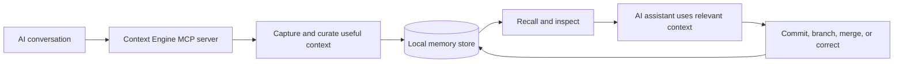

<div align="center">

# ⚡ Context Engine

### Persistent memory for AI coding agents.

**A local-first MCP server for carrying useful context, decisions, and project history across AI sessions.**

<p>
  <a href="https://www.npmjs.com/package/@sham-sundar-senthil-kumar/mcp-server">
    
  </a>
  <a href="https://registry.modelcontextprotocol.io/v0.1/servers?search=io.github.shamsundarsk%2Fmcp-server">
    
  </a>
  <a href="https://github.com/shamsundarsk/contextengine-">
    
  </a>
  
</p>

[Quick start](#-quick-start) · [Features](#-why-context-engine) · [Tools](#-available-tools) · [How it works](#-how-it-works) · [Configuration](#-configuration) · [Contributing](#-contributing)

</div>

---

## The problem

AI coding sessions are powerful—but context often disappears between conversations. Decisions get repeated, project history gets lost, and developers spend time re-explaining the same codebase.

**Context Engine gives compatible AI clients a persistent, queryable memory layer.** It is designed to keep useful project context available across sessions while giving developers ways to inspect, search, organize, and correct that memory.

> Think of it as a memory layer for your AI workflow—not another chat interface.

## ✨ Why Context Engine?

<table>
  <tr>
    <td width="50%">
      <h3>🧠 Persistent context</h3>
      Preserve important project knowledge so a new session can pick up where the previous one left off.
    </td>
    <td width="50%">
      <h3>🔎 Targeted recall</h3>
      Search stored context and decisions instead of relying only on the current conversation.
    </td>
  </tr>
  <tr>
    <td>
      <h3>🌿 Branches & history</h3>
      Separate experimental work, organize memory by branches, and support merge or rollback workflows.
    </td>
    <td>
      <h3>🛠️ Human override</h3>
      Inspect the memory graph and correct or prune inaccurate stored information when needed.
    </td>
  </tr>
  <tr>
    <td>
      <h3>🧹 Context curation</h3>
      Designed to prioritize durable decisions and useful context over transient debugging noise.
    </td>
    <td>
      <h3>🔌 MCP integration</h3>
      Expose memory capabilities to AI applications through the Model Context Protocol.
    </td>
  </tr>
</table>

## 🚀 Quick start

### Requirements

- Node.js 18 or later
- An MCP-compatible client
- Any additional credentials required by the features you enable

### Use with Claude Desktop

1. Install Node.js if it is not already installed.
2. Open Claude Desktop's MCP configuration file:
   - **macOS:** `~/Library/Application Support/Claude/claude_desktop_config.json`
   - **Windows:** `%APPDATA%\Claude\claude_desktop_config.json`
3. Add the following server entry:

```json
{
  "mcpServers": {
    "context-engine": {
      "command": "npx",
      "args": [
        "-y",
        "-p",
        "@sham-sundar-senthil-kumar/mcp-server@0.1.4",
        "context-engine-mcp"
      ]
    }
  }
}
```

If your configuration already has an `mcpServers` object, add only the `"context-engine"` entry inside it—don't overwrite your existing servers.

4. Save the file and fully restart Claude Desktop.
5. Open the MCP tools panel and check that Context Engine is available.

> **Tip:** The first launch downloads the package through npm, so it may take a little longer than later launches.

### Run it directly

You can also start the published server from a terminal:

```bash
npx -y -p @sham-sundar-senthil-kumar/mcp-server@0.1.4 context-engine-mcp
```

This starts an MCP server over standard input/output. It is intended to be launched by an MCP client; running it manually without sending MCP protocol messages will not open a chat UI.

## 🧰 Available tools

Context Engine exposes memory-management tools over MCP. The names below reflect the current tool interface; exact arguments and behavior are defined by the server implementation.

| Tool | Purpose |
|---|---|
| `gather_context` | Retrieve bounded saved context when starting a new session or restoring project context. |
| `get_context_tree` | Inspect the memory graph, including branches, commits, and memory statistics. |
| `override_memory_node` | Correct or prune a stored memory node. |
| `commit` | Save an important decision, schema, or fix as a durable memory milestone. |
| `recall` | Search past context and decisions using a query and supported scope. |
| `branch` | Create an isolated memory branch for experimental work. |
| `merge` | Merge changes from one memory branch into another. |
| `checkout` | Restore a previous memory state by selecting a commit. |

### Example workflow

1. Start a new AI session and retrieve relevant context with `gather_context`.
2. Search for a past design decision with `recall`.
3. Record a completed architectural decision with `commit`.
4. Create a branch before exploring a risky refactor.
5. Review or correct saved context using `get_context_tree` and `override_memory_node`.

Tool availability and required parameters depend on the server version and configuration. Consult the tool schemas exposed by your MCP client.

## ⚙️ How it works



The goal is a **hybrid-control workflow**: make useful memory accessible by default, while preserving explicit tools for inspecting and changing what has been stored.

## 🔐 Privacy & data

Context Engine is designed around local-first use. However, local-first does **not** automatically mean every operation is offline or that no data ever leaves your device.

- The MCP server runs in the environment where the client launches it.
- Review the configured providers, API keys, and integrations before using sensitive project data.
- Check the implementation and configuration to understand where memory is stored and whether any enabled model or embedding provider receives data.
- Treat stored context as project data: protect your machine, backups, and credentials accordingly.

**Before using this with confidential source code or personal information, review the data flow and provider settings for your specific setup.**

## 📦 Packages & links

| Resource | Link |
|---|---|
| npm package | [@sham-sundar-senthil-kumar/mcp-server](https://www.npmjs.com/package/@sham-sundar-senthil-kumar/mcp-server) |
| MCP Registry | [io.github.shamsundarsk/mcp-server](https://registry.modelcontextprotocol.io/v0.1/servers?search=io.github.shamsundarsk%2Fmcp-server) |
| Source code | [GitHub repository](https://github.com/shamsundarsk/contextengine-) |

## 🧑‍💻 Development

Clone the repository:

```bash
git clone https://github.com/shamsundarsk/contextengine-.git
cd contextengine-
npm install
```

Build the MCP server:

```bash
npm run build -w packages/mcp-server
```

If you're working on the core package as well, build it using the workspace script defined by the repository. The project uses a workspace layout, so run commands from the repository root unless a package script says otherwise.

## 🗺️ Roadmap

Potential areas for continued development:

- [ ] Expand integration and client setup guides
- [ ] Add end-to-end tests for core memory workflows
- [ ] Document configuration and storage behavior in detail
- [ ] Add troubleshooting guides and example workflows
- [ ] Improve security, dependency auditing, and release automation

## 🤝 Contributing

Ideas, bug reports, documentation improvements, and pull requests are welcome.

1. Open an issue describing the use case or bug.
2. Keep changes focused and include reproduction steps for bug reports.
3. Add or update tests where appropriate.
4. Submit a pull request with a clear summary.

Please avoid including real API keys, private project data, or other secrets in issues and pull requests.

## 📄 License

Check the repository's `LICENSE` file for the applicable license.

---

<div align="center">

**Less re-explaining. More building.**

*Context Engine — persistent memory for the work behind your code.*

</div>
